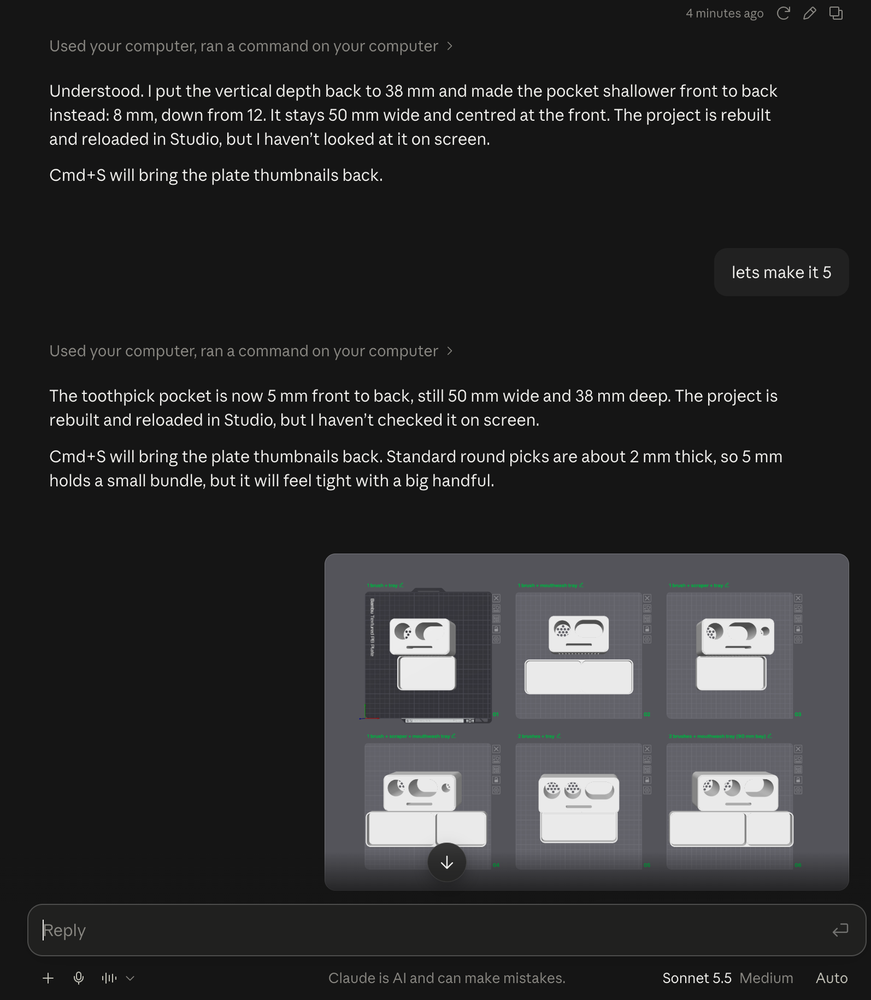
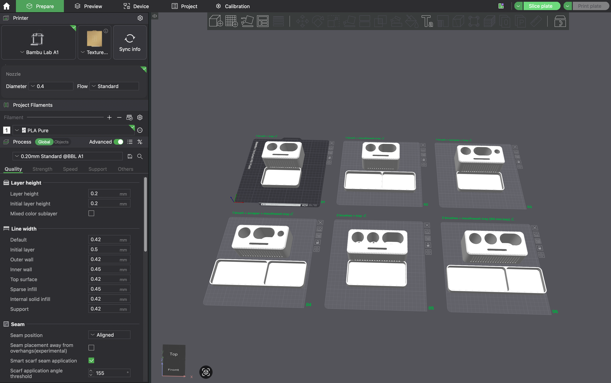

# Bambu Studio Model Builder

*A Claude skill that designs 3D-printable models and loads them straight into Bambu Studio. No downloading, no manual importing.*

> **Last tested:** October 27, 2026, on macOS with Bambu Studio 02.08.02.61, Bambu Lab A1, 0.4 nozzle, PLA.

## Why I built this

I was designing STL files with Claude, and every small change meant the same loop: download the new file, delete the old one in Bambu Studio, import the new one, and check how it looked. I wanted that gone.

I built this while making a holder for my toothbrush, tongue scraper, toothpaste, toothpicks and mouthwash. That took a lot of iterations, which is exactly the kind of project where the manual loop hurts most.

## What it does

You describe an object. Claude builds a parametric model, packs it as a Bambu Studio project file in your models folder, and reloads it in Studio. Say "make it taller" or "round the corners" and the new version appears in Studio a few seconds later.

## How it works

1. Claude builds the model with a short Python script (`build.py`).
2. It packs the result as a Studio-style `.3mf` that includes your printer, filament and process settings, so Studio opens it without a config warning.
3. It writes the file straight into your models folder.
4. It reloads the file in Studio by closing the project and reopening it from Recent projects.

## Your settings survive

Every rebuild replaces the file, but your saved print settings carry over. Filament colour, seam position and support settings were verified. The rule: settings only carry over once you have **saved** them in Studio. Unsaved changes are lost.

## Limitations

- **Studio does not refresh a file that changes on disk.** The workaround is the close-and-reopen step, which Claude does for you with computer use. If computer use is not available, close and reopen the file yourself.
- **Geometry edits made in Studio are lost on the next rebuild** (extra parts, moved objects, modifiers, painted supports), because the model is regenerated each time. A timestamped backup of the previous file is kept outside your models folder.
- One object and one plate only.
- Per-object overrides are carried over by the script but are untested.

## Requirements

- Claude Cowork in the Claude macOS app
- Bambu Studio
- One project saved from Bambu Studio in your models folder (see Setup)

You install nothing by hand. Python is part of the app's environment, and Claude installs the three libraries it needs (trimesh, manifold3d, numpy) after asking you.

## Setup

1. Open Bambu Studio, pick your printer and filament, and save an empty project into a folder for your models.
2. In Cowork, attach that folder with the **Add folder** button.
3. Install the skill (see below).
4. Ask Claude to design something.

The saved project is only the starting point. It carries your printer, filament and process settings. After the first build, the model's own file carries the settings forward.

## Install the skill

1. Download [`bambu-studio-model-builder.zip`](bambu-studio-model-builder.zip) from this repo (open the file on GitHub and click the download button). Don't unzip it.
2. In Claude, open **Settings > Capabilities** and make sure code execution and file creation is on.
3. In the **Skills** section, click **Upload skill** and pick the ZIP.
4. Switch the skill on.

The ZIP holds `SKILL.md` and `build.py` in one folder named after the skill, which is the layout Claude expects. If you change either file, rebuild the ZIP with the same folder name. See Anthropic's page on [using skills in Claude](https://support.claude.com/en/articles/12512180-using-skills-in-claude) for details. I only tested this skill in Cowork on macOS; the upload steps come from that page.

## Tested on

- macOS, Claude Cowork (Claude macOS app)
- Bambu Studio 02.08.02.61
- Bambu Lab A1, 0.4 nozzle, 0.20 mm Standard, PLA
- Date: October 27, 2026 (build, write and reload verified end to end)

**Not tested:** Windows, Linux, other printers, Claude Code in a terminal, models with more than one object, opening a never-opened file through File > Open Project with computer use.

## Disclaimer

Unofficial. Not affiliated with Bambu Lab.

## Licence

MIT. See LICENSE.
